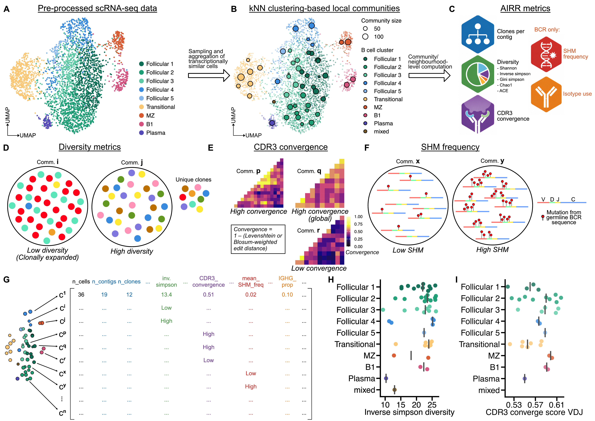

# TEVRA

TEVRA (Transcriptome Embedding-Resolved V(D)J Repertoire Analysis) maps
immune receptor repertoire features onto transcriptionally defined
aggregates in single-cell RNA-seq data.


## Installation

```r
# install.packages("remotes")
remotes::install_github("grace-hattersley/TEVRA")
```

## Getting started

See the complete [vignette](https://grace-hattersley.github.io/TEVRA/articles/TEVRA.html)
for a full workflow.

TEVRA takes a processed `SingleCellExperiment` object that has been pre-
processed, including reference alignment, transcript quantification, QC and cell 
annotation.

```r
library(TEVRA)
library(Seurat)
```

Aggregates can be pre-defined via the user's preferred method e.g., via *miloR* 
or *metacell*, or defined by TEVRA's 
[`create_communities()`](https://grace-hattersley.github.io/TEVRA/reference/create_communities.html) 
function.

```r
communities <- create_communities(sce_obj,
                                  graph.name = "RNA_snn",
                                  resolution = 5,
                                  min_cells = 5,
                                  feature.col = "nFeature_RNA",
                                  count.col = "nCount_RNA")
sce_obj <- communities$sce                                  
```

AIRR metrics can be computed per neighbourhood for `SingleCellExperiment` objects 
via specifying the column in `colData` that contains the neighbourhood ID

```r
sce_obj <- nhood_diversity(sce_obj,
                           nhood_col = "community_id",
                           clone_id_col = "clone",
                           min_n_contigs = 10,
                           metrics = c("shannon", "inv.simpson", "gini.simpson", "chao1"),
                           downsample_method = "rarefaction",
                           n_boots = 100)
```

For `Milo` objects, the function will extract the `nhoods` matrix directly

```r
milo_obj <- nhood_cdr3_convergence(object = milo_obj,
                                  nhood_col = NULL,
                                  receptor_type = "BCR",
                                  chain = "both",
                                  aa_col = c(VDJ = "aa_IGH", VJ = "aa_IGL"),
                                  clone_id_col = "clone",
                                  min_n_contigs = 10,
                                  distance_method = "levenshtein", 
                                  summary_metric = "converge_score",
                                  downsample = TRUE,
                                  n_boots = 100) 
```

Neighbourhood-level AIRR metrics can then be visualised

```r
plot_nhood_beeswarm(metadata(sce_obj)$nhood_analysis,
                    plot_cols = "clones_per_contig",
                    reliability_col = "diversity_reliable",
                    group_by = "identity",
                    summary_metric = "group_median",
                    colour_by = "identity",
                    size_by = "nhood_size")
```

## Example data



A) UMAP of murine splenocyte B cells. 
B) Community UMAP of murine splenocyte B cells following aggregation. ‘Mixed’ refers to communities where cells do not predominantly (>50%) belong to a single cluster.  Point computed as the median UMAP coordinates of all constituent cells of the community. Point size represents the number of cells in the community. 
C) AIRR metrics that can be computed per community. 
D) Representative image of low versus high diversity communities. 
E) Heatmaps demonstrating high local, high global and low CDR3 convergence communities. 
F) Representative image of low vs high SHM communities. 
G) Example of output dataframe from TEVRA workflow. 
H) Inverse Simpson diversity by community, grouped into cell type. 
I) CDR3 convergence score by community, grouped into cell type. CDR3 convergence scores were computed using Levenshtein edit distances.

## Citation

If you use TEVRA, please cite:

> Hattersley G, Lee C (2026). TEVRA: <TEVRA: Computes and Maps AIRR Features onto Transcriptionally Defined Cellular Aggregates>. R package version
> <0.0.0.9000>, https://github.com/grace-hattersley/TEVRA.

### Acknowledgements

TEVRA builds on several existing tools. If you use TEVRA, please also cite them.

**immApex**
The diversity functions used by `nhood_diversity()` are adapted from
[immApex](https://github.com/BorchLab/immApex) (Borcherding N et al.), which is
MIT-licensed. The original copyright notice and licence text are reproduced in
`inst/COPYRIGHTS`.

> Borcherding N, et al. (2026). Pre-transplant TCR Network Topology Predicts
> Kidney Allograft Rejection Independent of HLA Mismatch. *bioRxiv*.
> doi: [10.64898/2026.05.04.722749](https://doi.org/10.64898/2026.05.04.722749)

**miloR**
Neighbourhoods can be constructed using
[miloR](https://bioconductor.org/packages/miloR).

> Morgan M, Dann E (2026). miloR: Differential neighbourhood abundance testing
> on a graph. doi: [10.18129/B9.bioc.miloR](https://doi.org/10.18129/B9.bioc.miloR).
> R package version 2.8.1, https://bioconductor.org/packages/miloR.

**metacell**
Metacell-based neighbourhoods use
[metacell](https://github.com/tanaylab/metacell).

> Tanay A (2021). metacell: Meta cell analysis for single cell RNA-seq data.
> R package version 0.3.7, https://github.com/tanaylab/metacell.
