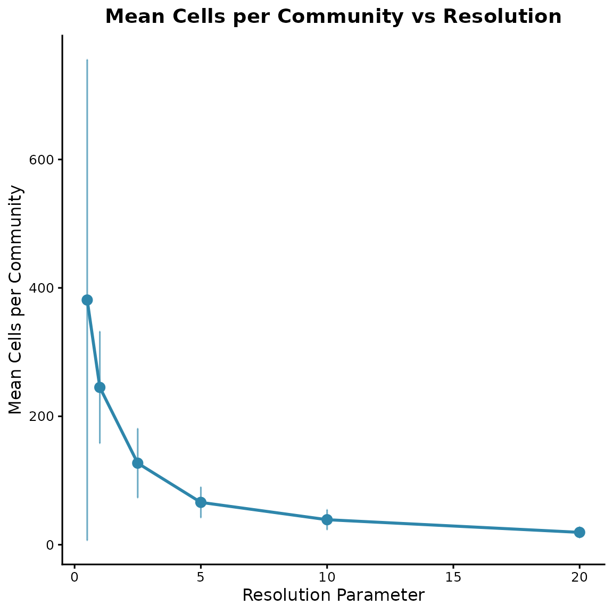
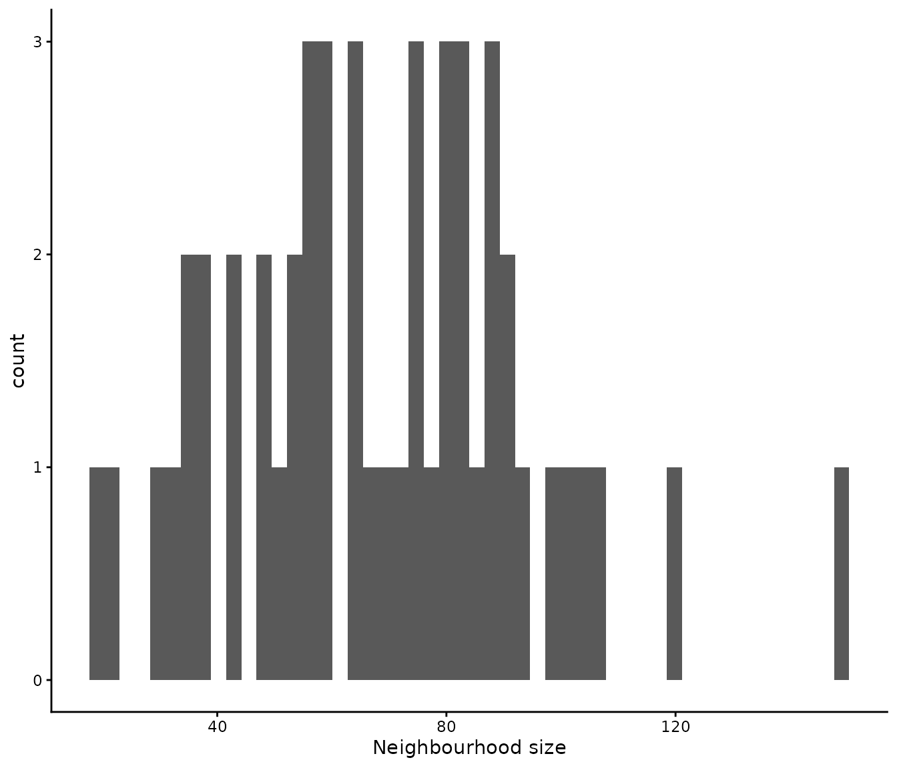
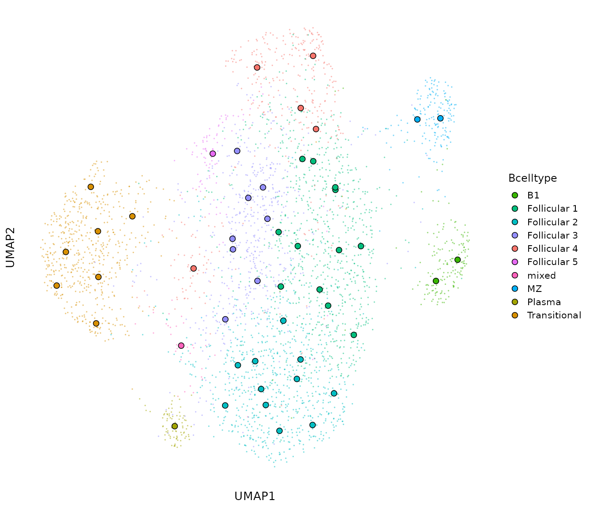
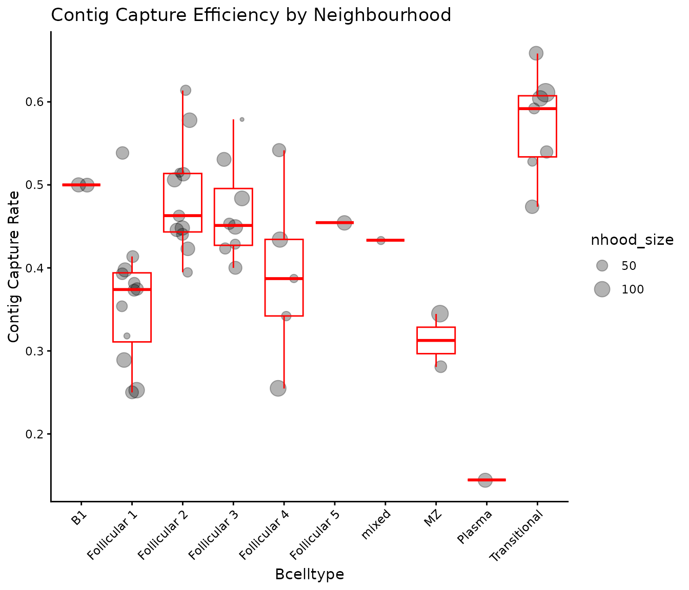
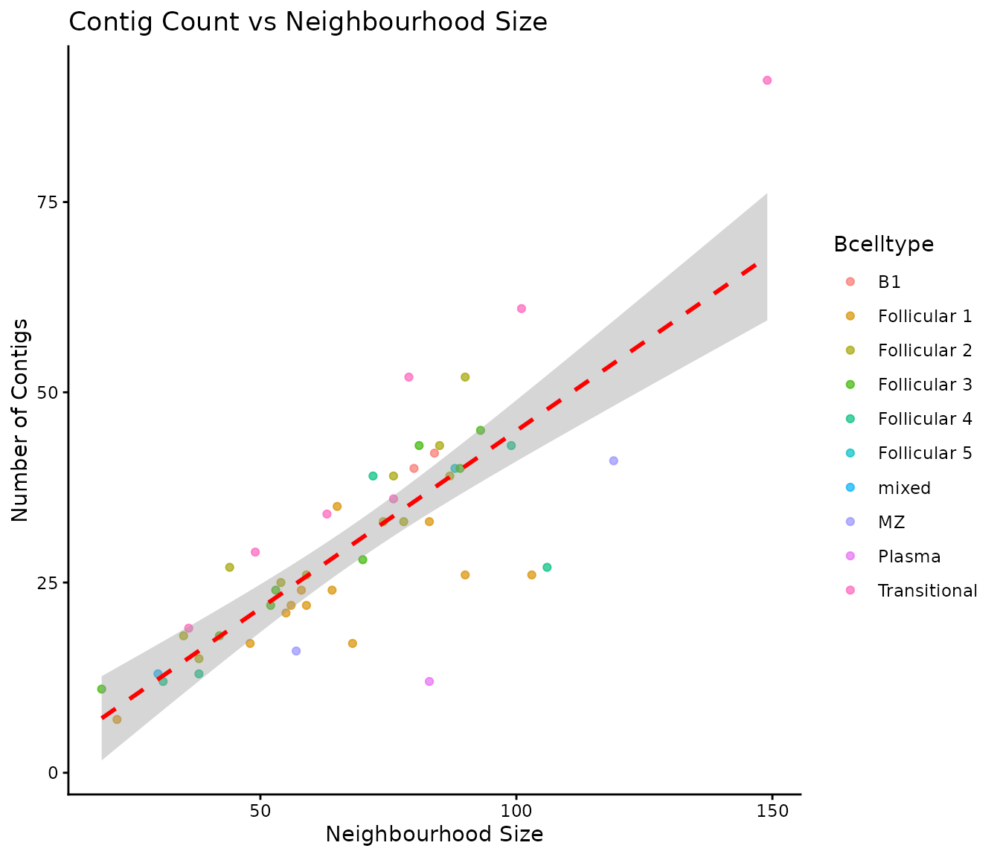
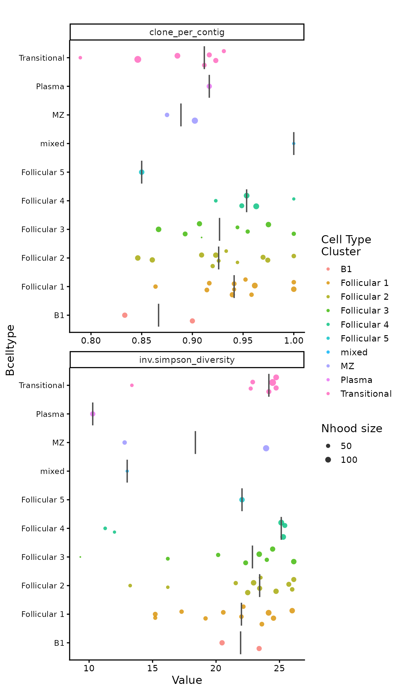
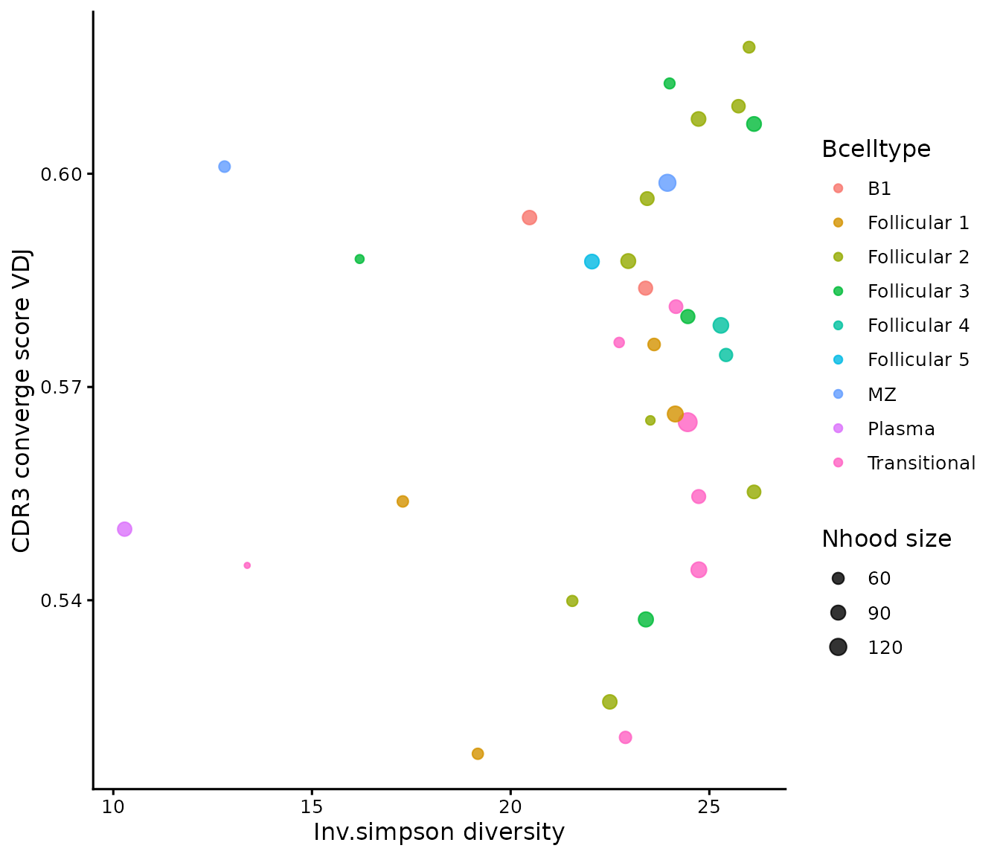

# TEVRA workflow

``` r

library(TEVRA)
library(SingleCellExperiment)

set.seed(0)
```

## Load data

TEVRA accepts a `SingleCellExperiment` object. Communities of
transcriptionally similar cells can be computed upstream of the TEVRA
workflow using any preferred method e.g., *miloR*, *metacell* or
*supercell*. If discrete communities have been defined, these should be
stored as a column in `colData(sce_object)`. If overlapping
neighbourhoods were computed e.g., via *miloR*, these should be stored
as a binary `nhoods` matrix.

``` r

data(tevra_example)
tevra_example
#> class: SingleCellExperiment 
#> dim: 2000 3430 
#> metadata(1): graphs
#> assays(1): logcounts
#> rownames(2000): Pcmtd1 Sgk3 ... CAAA01147332.1 AC149090.1
#> rowData names(0):
#> colnames(3430): AAACCTGAGTTACCCA-1 AAACCTGCAATGTTGC-1 ...
#>   TTTGTCATCACCGTAA-1 TTTGTCATCGCTAGCG-1
#> colData names(18): orig.ident nCount_RNA ... CTaa_BCR_IGH CTaa_BCR_IGL
#> reducedDimNames(2): PCA UMAP
#> mainExpName: RNA
#> altExpNames(0):
```

## Create communities

TEVRA also provides
[`create_communities()`](https://grace-hattersley.github.io/TEVRA/reference/create_communities.md),
a custom function for community detection. This operates via Leiden
partitioning of a pre-computed shared-nearest-neighbour graph. The key
parameters are:

- `resolution`: determines the granularity of clustering
- `min_cells`: informs the minimum number of cells per community. Cells
  belonging to communities with fewer cells are reassigned to the
  community occupied by the majority of the cell’s nearest neighbours

To establish communities of the desired size, different resolutions can
be evaluated via
[`test_resolution()`](https://grace-hattersley.github.io/TEVRA/reference/test_resolution.md)
and visualised via
[`plot_resolution_results()`](https://grace-hattersley.github.io/TEVRA/reference/plot_resolution_results.md)

``` r

res_results <- test_resolution(tevra_example,
                               graph.name = "RNA_snn",
                               resolutions = c(0.5,1,2.5,5,10,20),
                               min_cells = 5)
#> Testing resolutions...
#> Resolution: 0.5
#> Resolution: 1
#> Resolution: 2.5
#> Resolution: 5
#> Resolution: 10
#> Resolution: 20
#> 
#> Resolution testing complete!
head(res_results)
#>   resolution n_communities mean_cells_per_community sd_cells_per_community
#> 1        0.5             9                381.11111             374.370954
#> 2        1.0            14                245.00000              87.088814
#> 3        2.5            27                127.03704              53.868416
#> 4        5.0            52                 65.96154              23.790723
#> 5       10.0            88                 38.97727              15.577007
#> 6       20.0           178                 19.26966               8.606612
#>   median_cells_per_community min_cells_per_community max_cells_per_community
#> 1                      168.0                      83                    1081
#> 2                      237.0                      83                     370
#> 3                      134.0                      27                     244
#> 4                       66.5                      22                     124
#> 5                       37.0                       9                      82
#> 6                       18.0                       5                      47
#>   modularity
#> 1  0.7002931
#> 2  0.7295705
#> 3  0.7035432
#> 4  0.6404798
#> 5  0.5851922
#> 6  0.4821389
```

``` r

plot_resolution_results(res_results, 
                        show_error_bars = TRUE)
```



Once the optimal resolution has been selected, communities can be
generated via
[`create_communities()`](https://grace-hattersley.github.io/TEVRA/reference/create_communities.md)
and community sizes evaluated via
[`plot_nhood_sizes()`](https://grace-hattersley.github.io/TEVRA/reference/plot_nhood_sizes.md)

``` r

communities <- create_communities(tevra_example,
                                  graph.name = "RNA_snn",
                                  resolution = 5,
                                  min_cells = 5,
                                  feature.col = "nFeature_RNA",
                                  count.col = "nCount_RNA")
#> [1] "Created 50 communities"
#> [1] "Mean cells per community: 68.6"
communities
#> $sce
#> class: SingleCellExperiment 
#> dim: 2000 3430 
#> metadata(1): graphs
#> assays(1): logcounts
#> rownames(2000): Pcmtd1 Sgk3 ... CAAA01147332.1 AC149090.1
#> rowData names(0):
#> colnames(3430): AAACCTGAGTTACCCA-1 AAACCTGCAATGTTGC-1 ...
#>   TTTGTCATCACCGTAA-1 TTTGTCATCGCTAGCG-1
#> colData names(19): orig.ident nCount_RNA ... CTaa_BCR_IGL community_id
#> reducedDimNames(2): PCA UMAP
#> mainExpName: RNA
#> altExpNames(0):
#> 
#> $communities_summary
#> # A tibble: 50 × 4
#>    community_id n_cells mean_detected mean_total_counts
#>           <dbl>   <int>         <dbl>             <dbl>
#>  1            1      99         1989.             4771.
#>  2            2      49         1989.             4218.
#>  3            3      83         1366.             2199.
#>  4            4      84         2003.             4965.
#>  5            5      80         2139.             5694.
#>  6            6      58         1881.             4352.
#>  7            7      90         2056.             4813.
#>  8            8      74         1813.             4176.
#>  9            9      72         2072.             4912.
#> 10           10      54         1935.             4383.
#> # ℹ 40 more rows

sce_obj <- communities$sce
```

``` r

plot_nhood_sizes(communities$communities_summary)
```



A neighbourhood-level UMAP can be generated via aggregating (mean or
median) the consistuent cells’ individual UMAP coordinates per
neighbourhood

``` r

sce_obj <- nhood_umap(sce_obj,
                      nhood_col = "community_id",
                      aggregate_fun = "median",
                      result_name   = "nhood_umap")
#> Neighbourhood UMAP centroids (median) for 50 neighbourhoods stored in metadata(object)[['nhood_umap']].

head(metadata(sce_obj)$nhood_umap)
#>   nhood nhood_size median_UMAP_1 median_UMAP_2
#> 1     1         99    -0.1635164    3.39397471
#> 2     2         49    -6.7208307   -0.48542459
#> 3     3         83    -2.8592288   -2.98583253
#> 4     4         84     5.6871135   -0.40307231
#> 5     5         80     6.3954184   -0.02601494
#> 6     6         58     2.3985686    1.21709789
```

## Neighbourhood level analysis

Once cells are aggregated into transcriptionally-defined neighbourhoods,
these can be fed into TEVRA’s neighbourhood-level analysis functions.

### Neighbourhood annotation

Each neighbourhood can be annotated according to the most common
identity among its constituent cells. Specify one or more `colData`
columns in `annotation_cols`. For each column, the most frequent value
across the neighbourhood’s cells becomes the neighbourhood’s annotation,
provided it accounts for a proportion of cells above the defined
`threshold`.

``` r

sce_obj <- nhood_annotation(object = sce_obj,
                            annotation_cols = "Bcelltype",
                            nhood_col = "community_id",
                            threshold = 0.5,
                            result_name = "nhood_annotation")
#> Annotation column 'Bcelltype':
#>   49 / 50 neighbourhoods assigned a dominant identity (threshold = 0.50).
#>   1 / 50 neighbourhoods labelled 'mixed' (no identity exceeded threshold = 0.50).
#>   Dominant identity breakdown:
#>     Follicular 1: 12 neighbourhood(s)
#>     Follicular 2: 11 neighbourhood(s)
#>     Follicular 3: 8 neighbourhood(s)
#>     Transitional: 7 neighbourhood(s)
#>     Follicular 4: 5 neighbourhood(s)
#>     B1: 2 neighbourhood(s)
#>     MZ: 2 neighbourhood(s)
#>     Follicular 5: 1 neighbourhood(s)
#>     Plasma: 1 neighbourhood(s)
#> Stored annotation results (50 neighbourhoods x 1 annotation column(s)) in metadata(object)[['nhood_annotation']].

head(metadata(sce_obj)$nhood_annotation)
#>   nhood nhood_size    Bcelltype Bcelltype_dominant_prop
#> 1     1         99 Follicular 4               0.9191919
#> 2     2         49 Transitional               1.0000000
#> 3     3         83       Plasma               1.0000000
#> 4     4         84           B1               0.9761905
#> 5     5         80           B1               0.9750000
#> 6     6         58 Follicular 1               0.7068966
```

To investigatethe proportion of cells per neighbourhood with each
identity without assigning a neighbourhood annotation, run
[`nhood_annotation_props()`](https://grace-hattersley.github.io/TEVRA/reference/nhood_annotation_props.md)

### Neighbourhood diversity

The clonal repertoire of each neighbourhood is summarised using
[`nhood_diversity()`](https://grace-hattersley.github.io/TEVRA/reference/nhood_diversity.md),
selecting the specific diversity metrics desired from:

- `shannon`:
- `norm.entropy`
- `inv.simpson`
- `gini.simpson`
- `chao1`
- `ace`
- `gini`
- `standardised_n_clones`

If clones have not been defined, the raw cdr3 sequence is used as a
surrogate, although this is not recommended for B cells due to the
potential for significant sequence modification within clones via
somatic hypermutation. Metrics are not computed for neighbourhoods with
less than `min_n_contigs` as diversity estimates are unstable at low
sample sizes. Rarefaction or coverage- based standardisation is
recommended due to the sensitivity of diversity estimates to sampling
depth

``` r

sce_obj <- nhood_diversity(sce_obj,
                           nhood_col = "community_id",
                           clone_id_col = "CTstrict_BCR",
                           cdr3_col = "CTnt_BCR",
                           min_n_contigs = 10,
                           metrics = c("shannon", "inv.simpson", "gini.simpson", "chao1"),
                           downsample_method = "rarefaction",
                           n_boots = 100,
                           feature_scale = FALSE,
                           result_name = "nhood_diversity")
#> Warning in nhood_diversity(sce_obj, nhood_col = "community_id", clone_id_col =
#> "CTstrict_BCR", : Rarefaction is not compatible with chao1 or ace estimators.
#> These metrics will be computed on observed counts without rarefaction.
#> _diversity_sd will be NA for these metrics.
#> Contig summary:
#> Cells with contig: 1515 / 3430
#> Neighbourhoods with >= 10 cells with contig: 49 / 50
#> Rarefaction depth: 27
#> Neighbourhoods successfully rarefied (n_contigs > rarefaction depth): 24 / 49
#> Stored diversity results (50 neighbourhoods x 4 metrics) in metadata(object)[['nhood_diversity']].

head(metadata(sce_obj)$nhood_diversity)
#>   nhood nhood_size n_contigs contig_capture_rate n_clones clone_per_contig
#> 1     1         99        43           0.4343434       41        0.9534884
#> 2    10         54        25           0.4629630       23        0.9200000
#> 3    11         68        17           0.2500000       16        0.9411765
#> 4    12         90        26           0.2888889       26        1.0000000
#> 5    13        119        41           0.3445378       37        0.9024390
#> 6    14         87        39           0.4482759       36        0.9230769
#>     coverage diversity_reliable shannon_diversity shannon_diversity_sd
#> 1 0.09302326               TRUE          3.254248           0.03476596
#> 2 0.16000000               TRUE          3.107972                   NA
#> 3 0.11764706               TRUE          2.751667                   NA
#> 4 0.00000000               TRUE          3.258097                   NA
#> 5 0.19512195               TRUE          3.208038           0.04911501
#> 6 0.15384615               TRUE          3.221388           0.04401398
#>   inv.simpson_diversity inv.simpson_diversity_sd gini.simpson_diversity
#> 1              25.29050                 1.110711              0.9605761
#> 2              21.55172                       NA              0.9536000
#> 3              15.21053                       NA              0.9342561
#> 4              26.00000                       NA              0.9615385
#> 5              23.94501                 1.595969              0.9577503
#> 6              24.72817                 1.296804              0.9587929
#>   gini.simpson_diversity_sd chao1_diversity chao1_diversity_sd
#> 1               0.001975085           288.0                 NA
#> 2                        NA            93.0                 NA
#> 3                        NA            68.5                 NA
#> 4                        NA            26.0                 NA
#> 5               0.002571843           142.6                 NA
#> 6               0.002152818           168.0                 NA
```

### Neighbourhood cdr3 convergence

The similarity of the CDR3 amino acid sequences of different clones is
computed using
[`nhood_cdr3_convergence()`](https://grace-hattersley.github.io/TEVRA/reference/nhood_cdr3_convergence.md).
This is computed for both heavy and light chain CDR3 sequences when
`chain` = “both”.

Pairwise distances are computed via *pwalign*’s `stringDist()` function
across all unique (or representative when `receptor_type` = “BCR”) CDR3
amino acid sequences per neighbourhood exceeding min_n_contigs and
optionally min_clones. These are either traditional Levenshtein
distances or calculated using BLOSUM-weighted substitution scores. Raw
alignment distances are then normalised to \[0,1\] by dividing by the
length of the longer sequence in each pair. To control for variation in
clone number across neighbourhoods, distance matrices may be downsampled
over `n_boots` iterations.

Pairwise distances matrices are summarised per neighbourhood as a global
convergence score (mean or median pairwise distance across all
representative CDR3 sequences), or a local convergence score (mean
distance of each CDR3 sequence to its k nearest neighbours, averaged
across representatives). Finally, all distance-based metrics are
converted to convergence scores via \\1 - distance\\.

``` r

sce_obj <- nhood_cdr3_convergence(object = sce_obj,
                                  nhood_col ="community_id",
                                  receptor_type = "BCR",
                                  chain = "both",
                                  aa_col = c(VDJ = "CTaa_BCR_IGH", VJ = "CTaa_BCR_IGL"),
                                  clone_id_col = "CTstrict_BCR",
                                  min_n_contigs = 10,
                                  min_clones = NULL,
                                  distance_method = "levenshtein", 
                                  summary_metric = "converge_score",
                                  downsample = TRUE,
                                  n_boots = 100,
                                  BPPARAM = BiocParallel::SerialParam(),
                                  result_name = "nhood_cdr3_convergence") 
#> Extracting neighbourhood membership...
#> Filtering to cells with complete contig annotation...
#> Pre-pass: counting clones per neighbourhood...
#>   VDJ: 33 / 50 neighbourhoods will be processed (downsampling depth = 16 representatives) | 17 skipped (< 10 cells with contig annotation)
#>   VJ: 49 / 50 neighbourhoods will be processed (downsampling depth = 26 representatives) | 1 skipped (< 10 cells with contig annotation)
#> Computing CDR3 distances for 49 valid neighbourhoods (of 50 total)...
#>   Processing neighbourhood 5 / 50 (10%)...
#>   Processing neighbourhood 10 / 50 (20%)...
#>   Processing neighbourhood 15 / 50 (30%)...
#>   Processing neighbourhood 20 / 50 (40%)...
#>   Processing neighbourhood 25 / 50 (50%)...
#>   Processing neighbourhood 30 / 50 (60%)...
#>   Processing neighbourhood 35 / 50 (70%)...
#>   Processing neighbourhood 40 / 50 (80%)...
#>   Processing neighbourhood 45 / 50 (90%)...
#>   Processing neighbourhood 50 / 50 (100%)...
#> Collating results...
#> 
#> CDR3 convergence score computation complete.
#>   Receptor type  : BCR
#>   Distance method: levenshtein
#>   Chain(s)       : VDJ, VJ
#>   Summary metric(s): converge_score
#>   VDJ: 33 / 50 neighbourhoods with reliable convergence estimates (0 with NA converge_score due to n_clones <= k)
#>   VJ: 49 / 50 neighbourhoods with reliable convergence estimates (0 with NA converge_score due to n_clones <= k)
#> Stored CDR3 convergence results (50 neighbourhoods x 14 columns) in metadata(object)[['nhood_cdr3_convergence']].

head(metadata(sce_obj)$nhood_cdr3_convergence)
#>   nhood nhood_size VDJ_n_contigs VDJ_contig_capture_rate VDJ_n_clones
#> 1     1         99            24               0.2424242           23
#> 2     2         49            24               0.4897959           23
#> 3     3         83            11               0.1325301           10
#> 4     4         84            28               0.3333333           23
#> 5     5         80            26               0.3250000           25
#> 6     6         58             9               0.1551724            8
#>   VDJ_converge_score_reliable CDR3_converge_score_VDJ
#> 1                        TRUE                0.578668
#> 2                        TRUE                0.576261
#> 3                        TRUE                0.550000
#> 4                        TRUE                0.593832
#> 5                        TRUE                0.583904
#> 6                       FALSE                      NA
#>   CDR3_converge_score_sd_VDJ VJ_n_contigs VJ_contig_capture_rate VJ_n_clones
#> 1                 0.02072197           43              0.4343434          41
#> 2                 0.01761828           29              0.5918367          27
#> 3                         NA           12              0.1445783          11
#> 4                 0.01817885           42              0.5000000          35
#> 5                 0.01668564           40              0.5000000          36
#> 6                         NA           24              0.4137931          23
#>   VJ_converge_score_reliable CDR3_converge_score_VJ CDR3_converge_score_sd_VJ
#> 1                       TRUE               0.691739               0.017611755
#> 2                       TRUE               0.634082               0.003144673
#> 3                       TRUE               0.635000                        NA
#> 4                       TRUE               0.647581               0.012022132
#> 5                       TRUE               0.641388               0.015655762
#> 6                       TRUE               0.656900                        NA
```

To investigate the raw convergence matrices without neighbourhood-level
summarisation, run
[`nhood_cdr3_convergence_matrices()`](https://grace-hattersley.github.io/TEVRA/reference/nhood_cdr3_convergence_matrices.md).

### Merge neighbourhood-level analysis

[`merge_nhood_results()`](https://grace-hattersley.github.io/TEVRA/reference/merge_nhood_results.md)
easily aggregates all neighbourhood-level analyses into a single
dataframe for plotting and visualisation purposes.

``` r

sce_obj <- merge_nhood_results(object = sce_obj,
                               dataframe_names = c("nhood_umap", "nhood_annotation", 
                                "nhood_diversity", "nhood_cdr3_convergence"),
                               merge_key = "nhood",
                               size_col = "nhood_size",
                               verbose = TRUE,
                               result_name = "merged_nhood_analysis")
#> ======================================================================
#> Merging Neighbourhood Analysis Results
#> ======================================================================
#> Checking available data (4 requested):
#>   nhood_umap: ✓ Found
#>   nhood_annotation: ✓ Found
#>   nhood_diversity: ✓ Found
#>   nhood_cdr3_convergence: ✓ Found
#> Input dimensions:
#>   nhood_umap                          50 rows × 4 columns
#>   nhood_annotation                    50 rows × 4 columns
#>   nhood_diversity                     50 rows × 16 columns
#>   nhood_cdr3_convergence              50 rows × 14 columns
#> Validating neighbourhood consistency...
#> ----------------------------------------------------------------------
#>   ✓ 'nhood_umap' vs 'nhood_annotation': all 50 neighbourhoods shared
#>   ✓ 'nhood_umap' vs 'nhood_annotation': size column ('nhood_size') IDENTICAL across all 50 shared neighbourhoods
#>   ✓ 'nhood_umap' vs 'nhood_diversity': all 50 neighbourhoods shared
#>   ✓ 'nhood_umap' vs 'nhood_diversity': size column ('nhood_size') IDENTICAL across all 50 shared neighbourhoods
#>   ✓ 'nhood_umap' vs 'nhood_cdr3_convergence': all 50 neighbourhoods shared
#>   ✓ 'nhood_umap' vs 'nhood_cdr3_convergence': size column ('nhood_size') IDENTICAL across all 50 shared neighbourhoods
#> ----------------------------------------------------------------------
#> Performing sequential merge on 'nhood' column...
#>   Step 1: 'nhood_umap'  +  'nhood_annotation'
#>   Checking 1 common column(s) between 'nhood_umap' and 'nhood_annotation':
#>     ✓ nhood_size                     IDENTICAL
#>   Removing 1 redundant column(s) from 'nhood_annotation': nhood_size
#>     → 50 rows × 6 columns
#>   Step 2: 'nhood_umap + nhood_annotation'  +  'nhood_diversity'
#>   Checking 1 common column(s) between 'nhood_umap + nhood_annotation' and 'nhood_diversity':
#>     ✓ nhood_size                     IDENTICAL
#>   Removing 1 redundant column(s) from 'nhood_diversity': nhood_size
#>     → 50 rows × 20 columns
#>   Step 3: 'nhood_umap + nhood_annotation + nhood_diversity'  +  'nhood_cdr3_convergence'
#>   Checking 1 common column(s) between 'nhood_umap + nhood_annotation + nhood_diversity' and 'nhood_cdr3_convergence':
#>     ✓ nhood_size                     IDENTICAL
#>   Removing 1 redundant column(s) from 'nhood_cdr3_convergence': nhood_size
#>     → 50 rows × 32 columns
#> Stored merged results (50 rows × 32 columns) in metadata(object)[['merged_nhood_analysis']].
```

## Plot

TEVRA offers a number of visualisation functions. Each neighbourhood is
visualised as a point.

### Neighbourhood UMAP

``` r

cell_umap_coords <- as.data.frame(reducedDims(sce_obj)$UMAP)
summary(row.names(cell_umap_coords) == row.names(colData(sce_obj)))
#>    Mode    TRUE 
#> logical    3430
cell_umap_coords$community_id <- colData(sce_obj)$community_id

plot_nhood_umap(metadata(sce_obj)$merged_nhood_analysis,
                nhood_col = "nhood",
                x_col = "median_UMAP_1",
                y_col = "median_UMAP_2",
                fill_by = "Bcelltype",
                show_cells = T,
                cell_umap_coords = cell_umap_coords,
                cell_x_col = "umap_1",
                cell_y_col = "umap_2",
                cell_colour_by = "nhood",
                cell_nhood_col = "community_id")
```



### Capture efficiency

Visualises the efficiency of contig capture per neighbourhood. Follows
[`nhood_diversity()`](https://grace-hattersley.github.io/TEVRA/reference/nhood_diversity.md)

``` r

plot_capture_efficiency(nhood_diversity_df = metadata(sce_obj)$merged_nhood_analysis, 
                        group_by = "Bcelltype") 
#> $capture_rate
```



    #> 
    #> $count_vs_size
    #> `geom_smooth()` using formula = 'y ~ x'



### Beeswarm

``` r

plot_nhood_beeswarm(metadata(sce_obj)$merged_nhood_analysis,
                    plot_cols = c("clone_per_contig" , "inv.simpson_diversity"),
                    reliability_col = "diversity_reliable",
                    group_by = "Bcelltype",
                    summary_metric = "group_median",
                    colour_by = "Bcelltype",
                    size_by = "nhood_size")
#> Orientation inferred to be along y-axis; override with
#> `position_quasirandom(orientation = 'x')`
```



### Scatter plot

``` r

plot_nhood_scatter(metadata(sce_obj)$merged_nhood_analysis,
                   x_col = "inv.simpson_diversity",
                   y_col = "CDR3_converge_score_VDJ",
                   x_reliability_col = "diversity_reliable",
                   y_reliability_col = "VDJ_converge_score_reliable",
                   colour_by = "Bcelltype",
                   size_by = "nhood_size")
```


