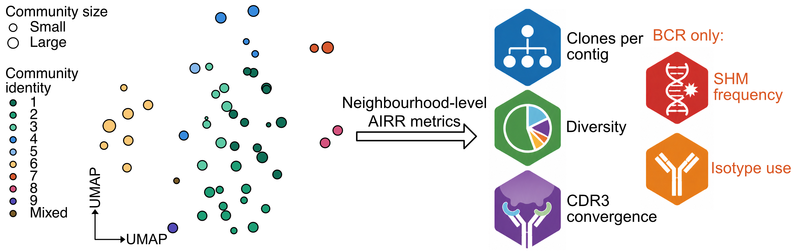

# TEVRA

TEVRA (Transcriptome Embedding-Resolved V(D)J Repertoire Analysis) maps
immune receptor repertoire features onto transcriptionally defined
neighbourhoods in single-cell RNA-seq data.



TEVRA summary

## Installation

``` r

# install.packages("remotes")
remotes::install_github("grace-hattersley/TEVRA")
```

## Getting started

See the complete
[vignette](https://grace-hattersley.github.io/TEVRA/articles/TEVRA.html)
for a full workflow.

TEVRA takes a processed `SingleCellExperiment` object.

``` r

library(TEVRA)
library(Seurat)
```

Neighbourhoods can be pre-defined via the user’s preferred method, or
defined by TEVRA’s
[`create_communities()`](https://grace-hattersley.github.io/TEVRA/reference/create_communities.html)
function.

``` r

communities <- create_communities(sce_obj,
                                  graph.name = "RNA_snn",
                                  resolution = 5,
                                  min_cells = 5,
                                  feature.col = "nFeature_RNA",
                                  count.col = "nCount_RNA")
sce_obj <- communities$sce                                  
```

AIRR metrics can be computed per neighbourhood for
`SingleCellExperiment` objects via specifying the column in `colData`
that contains the neighbourhood ID

``` r

sce_obj <- nhood_diversity(sce_obj,
                           nhood_col = "community_id",
                           clone_id_col = "clone",
                           min_n_contigs = 10,
                           metrics = c("shannon", "inv.simpson", "gini.simpson", "chao1"),
                           downsample_method = "rarefaction",
                           n_boots = 100)
```

For `Milo` objects, the function will extract the `nhoods` matrix
directly

``` r

milo_obj <- nhood_cdr3_convergence(object = milo_obj,
                                  nhood_col = NULL,
                                  receptor_type = "BCR",
                                  chain = "both",
                                  aa_col = c(VDJ = "aa_IGH", VJ = "aa_IGL"),
                                  clone_id_col = "clone",
                                  min_n_contigs = 10,
                                  distance_method = "levenshtein", 
                                  summary_metric = "converge_score",
                                  downsample = TRUE,
                                  n_boots = 100) 
```

Neighbourhood-level AIRR metrics can then be visualised

``` r

plot_nhood_beeswarm(metadata(sce_obj)$nhood_analysis,
                    plot_cols = "clones_per_contig",
                    reliability_col = "diversity_reliable",
                    group_by = "identity",
                    summary_metric = "group_median",
                    colour_by = "identity",
                    size_by = "nhood_size")
```
