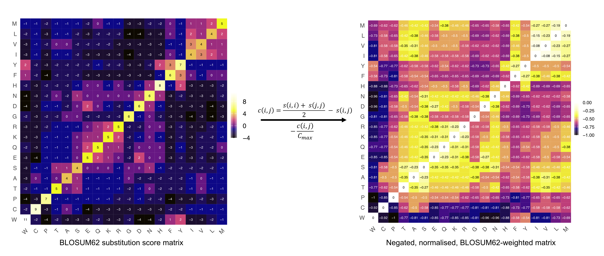

```{r, include = FALSE}
knitr::opts_chunk$set(
  collapse = TRUE,
  comment = "#>"
)
```

```{r setup, message = FALSE, warning = FALSE}
library(TEVRA)
library(SingleCellExperiment)

set.seed(0)
```

## Load data
TEVRA accepts a `SingleCellExperiment` object that has been pre-processed, including reference alignment, transcript quantification, QC and cell annotation. 

```{r load-data}
data(tevra_example)
tevra_example
```

## Defining cellular aggregates
Communities of transcriptionally similar cells can be computed upstream of the 
TEVRA workflow using any preferred method e.g., *miloR*, *metacell* or 
*supercell*. If discrete communities have been defined, these should be stored 
as a column in `colData(sce_object)`. If overlapping neighbourhoods were 
computed e.g., via *miloR*, these should be stored as a binary `nhoods` matrix.

We recommend utilising purpose-built softwares for community detection such as 
the methods listed above for more robust cell aggregation. However, TEVRA can 
also do this natively with create_communities(), a custom function for community detection, by Leiden partitioning of the shared-nearest-neighbour graph. The key parameters are:

- `resolution`: determines the granularity of clustering
- `min_cells`: informs the minimum number of cells per community. Cells belonging 
to communities with fewer cells are reassigned to the community occupied by the 
majority of the cell's nearest neighbours

To establish communities of the desired size, different resolutions can be 
evaluated via `test_resolution()` and visualised via `plot_resolution_results()`
```{r test_resolution}
res_results <- test_resolution(tevra_example,
                               graph.name = "RNA_snn",
                               resolutions = c(0.5,1,2.5,5,10,20),
                               min_cells = 5)
head(res_results)
```

```{r plot_resolution_results, fig.width = 6, fig.height = 6}
plot_resolution_results(res_results, 
                        show_error_bars = TRUE)
```

Once the optimal resolution has been selected, communities can be generated via
`create_communities()` and community sizes evaluated via `plot_nhood_sizes()`
```{r create_communities}
communities <- create_communities(tevra_example,
                                  graph.name = "RNA_snn",
                                  resolution = 5,
                                  min_cells = 5,
                                  feature.col = "nFeature_RNA",
                                  count.col = "nCount_RNA")
communities

sce_obj <- communities$sce
```

```{r plot_nhood_sizes, fig.width = 7, fig.height = 6}
plot_nhood_sizes(communities$communities_summary)
```

A community-level UMAP can be generated via aggregating (mean or median) 
the consistuent cells' individual UMAP coordinates per community
```{r nhood_umap}
sce_obj <- nhood_umap(sce_obj,
                      nhood_col = "community_id",
                      aggregate_fun = "median",
                      result_name   = "nhood_umap")

head(metadata(sce_obj)$nhood_umap)
```

## Aggregate-level analysis
Once cells are aggregated into transcriptionally-defined clusters, these 
can be fed into TEVRA's aggregate-level analysis functions. 

### Cell type annotation
Each aggregate can be annotated according to the most common identity among 
its constituent cells. Specify one or more `colData` columns in 
`annotation_cols`. For each column, the most frequent value across the 
aggregate’s cells becomes the aggregate’s annotation, provided it 
accounts for a proportion of cells above the defined `threshold`. 

```{r nhood_annotation}
sce_obj <- nhood_annotation(object = sce_obj,
                            annotation_cols = "Bcelltype",
                            nhood_col = "community_id",
                            threshold = 0.5,
                            result_name = "nhood_annotation")

head(metadata(sce_obj)$nhood_annotation)
```

To investigate the proportion of cells per aggregate with each identity 
without assigning an annotation, run `nhood_annotation_props()`

### Isotype annotation
`nhood_annotation()` can additionally be used to annotate isotype usage (e.g., 
IGHD, IGHM, IGHA, IGHG) per cellular aggregate. 

### Clonal diversity
The clonal repertoire of each aggregate is summarised using 
`nhood_diversity()`. This function incorporates a number of different methods to
summarise clonal diversity. The most simple is `clones_per_contig`, which is always reported in the output and informs the proportion of recovered contigs that 
represent a unique clone. The other available metrics are listed below and must 
be selected by the user to be calculated:

- `shannon`:
- `norm.entropy`
- `inv.simpson`
- `gini.simpson`
- `chao1`
- `ace`
- `gini`
- `standardised_n_clones`

If clones have not been defined, the cdr3 sequence is used as a surrogate, 
although this is not recommended for B cells due to the potential for 
significant sequence modification within clones via somatic hypermutation. 
Metrics are not computed for aggregates with less than `min_n_contigs` as 
diversity estimates are unstable at low sample sizes. Rarefaction or coverage-
based standardisation is recommended due to the sensitivity of diversity 
estimates to sampling depth

```{r nhood_diversity}
sce_obj <- nhood_diversity(sce_obj,
                           nhood_col = "community_id",
                           clone_id_col = "CTstrict_BCR",
                           cdr3_col = "CTnt_BCR",
                           min_n_contigs = 10,
                           metrics = c("shannon", "inv.simpson", "gini.simpson", "chao1"),
                           downsample_method = "rarefaction",
                           n_boots = 100,
                           feature_scale = FALSE,
                           result_name = "nhood_diversity")

head(metadata(sce_obj)$nhood_diversity)
```

### Inter-clonal cdr3 convergence
TEVRA provides a novel inter-clonal CDR3 convergence metric computed via 
`nhood_cdr3_convergence()`. This reports the similarity of the CDR3 amino acid 
sequences between distinct clonotypes, within each aggregate. An aggregate with
high CDR3 convergence represents one in which clonotypes are converging onto a 
similar CDR3 sequence, and therefore likely respond to the same epitope. 
Alternatively, an aggregate with low CDR3 convergence suggests clonotypes 
respond to multiple antigens or multiple epitopes of the same antigen with 
dissimilar sequences. The function computes this for both heavy and light chain 
CDR3 sequences when `chain` = "both". For more details on specifically how this
metric is computed, refer to the section at the end of this vignette.

The key metrics are:

- `receptor_type`: for TCRs, similarity scores are computed between each unique 
CDR3 sequence as these represent unique clones. For BCRs, somatic hypermutation 
enables CDR3 sequences of the same clone to have different sequences. Hence, a representative sequence is first selected per clone as the CDR3 sequence that is 
the most similar to all other CDR3 sequences of that clone
- `min_n_contigs`: the minimum number of contigs required per aggregate. Must 
exceed `min_clones`
- `min_clones`: the minimum number of clones required per aggregate
- `distance_method`: CDR3 sequences can differ by either insertions, deletions 
or substitutions. All insertions or deletions incur a cost of 1. Using 
Levenshtein distances, all substitutions also incur a cost of 1. Using blosum-
weighted distances, the cost of substitutions is weighted according to the 
biological significance of this substitution (see the end of the vignette for 
more details). A custom substitution matrix can also be supplied with unique 
substitution weightings, ranging from -1 (least costly substitution) to 0 (most 
costly substitution)
- `summary_metric`: inter-clonal convergence scores are summarised per aggregate either globally by providing the mean or median score or locally. Local convergence scores report the mean distance of each CDR3 sequence to its k nearest neighbours, averaged per aggregate (see the end of the vignette for more details).
- `downsample`: if TRUE, matrices of clonal convergence scores are downsampled to the median clonal count over `n_boots` iterations to control for variation in clone number across aggregates

```{r nhood_cdr3_convergence}
sce_obj <- nhood_cdr3_convergence(object = sce_obj,
                                  nhood_col ="community_id",
                                  receptor_type = "BCR",
                                  chain = "both",
                                  aa_col = c(VDJ = "CTaa_BCR_IGH", VJ = "CTaa_BCR_IGL"),
                                  clone_id_col = "CTstrict_BCR",
                                  min_n_contigs = 10,
                                  min_clones = NULL,
                                  distance_method = "levenshtein", 
                                  summary_metric = "converge_score",
                                  downsample = TRUE,
                                  n_boots = 100,
                                  BPPARAM = BiocParallel::SerialParam(),
                                  result_name = "nhood_cdr3_convergence") 

head(metadata(sce_obj)$nhood_cdr3_convergence)
```

To investigate the raw convergence matrices without 
neighbourhood-level summarisation, run `nhood_cdr3_convergence_matrices()`.

### Somatic hypermutation
BCR mutation frequency or counts can be calculated per aggregate using 
`nhood_shm()`. This function returns either the mean or median mutation metric 
and its standard deviation or interquartile range per aggregate.

### Merging multiple aggregate-level analysese
The above functions compute aggregate-level statistics for respective analyses. `merge_nhood_results()` easily aggregates all neighbourhood-level analyses into a single dataframe, so that each nhood has multiple AIRR metrics that can be jointly analysed. For example, following merging, users may cluster neighbourhoods using multiple parameters derived from the above analyses, such that V(D)J metrics can serve an independent axis for cell or aggregate identity.

```{r merge_nhood_results}
sce_obj <- merge_nhood_results(object = sce_obj,
                               dataframe_names = c("nhood_umap", "nhood_annotation", 
                                "nhood_diversity", "nhood_cdr3_convergence"),
                               merge_key = "nhood",
                               size_col = "nhood_size",
                               verbose = TRUE,
                               result_name = "merged_nhood_analysis")
```

## Plot
TEVRA offers a number of visualisation functions. Each neighbourhood is 
visualised as a point.

### Neighbourhood UMAP
The aggregated UMAP can be visualised via `plot_nhood_umap()`. This function enables, the aggregates to be plotted and to be optionally overlayed onto the original cell-level UMAP from which the aggregated coordinates are derived. If the user has also computed aggregate similarity weightings e.g., as obtained via *metacell*, these can also be plotted.

```{r plot_nhood_umap, fig.width = 7, fig.height = 6}
cell_umap_coords <- as.data.frame(reducedDims(sce_obj)$UMAP)
summary(row.names(cell_umap_coords) == row.names(colData(sce_obj)))
cell_umap_coords$community_id <- colData(sce_obj)$community_id

plot_nhood_umap(metadata(sce_obj)$merged_nhood_analysis,
                nhood_col = "nhood",
                x_col = "median_UMAP_1",
                y_col = "median_UMAP_2",
                fill_by = "Bcelltype",
                show_cells = T,
                cell_umap_coords = cell_umap_coords,
                cell_x_col = "umap_1",
                cell_y_col = "umap_2",
                cell_colour_by = "nhood",
                cell_nhood_col = "community_id")
```

### Capture efficiency
Visualises the efficiency of contig capture per neighbourhood. Follows 
`nhood_diversity()`

- `capture_rate` demonstrates the proportion of cells per aggregate with a recovered contig as a jitter plot with bix plot overlayed. This enables visual investigation of the rate of contig recovery per cell type
- `count_vs_size` is a scatter plot with a line of best fit overlayed, demonstrating the relationship between aggregate size and the number of contigs recovered. A positive, linear relationship is expected, with the number of contigs increasing with neighbourhood size.

```{r plot_capture_efficiency, fig.width = 7, fig.height = 6}
plot_capture_efficiency(nhood_diversity_df = metadata(sce_obj)$merged_nhood_analysis, 
                        group_by = "Bcelltype") 
```

### Beeswarm
`plot_nhood_beeswarm()` visualises neighbourhood analysis as a beeswarm plot. A plot is provided per metric listed in `plot_cols`, grouped by the column named in `group_by`, with further faceting by the metric listed in `facet_by`. The reliability column that corresponds to the metric to be plotted should be provided in `reliability_col` to ensure that aggregates that were excluded from the relevant analysis are not visualised. The user can choose via `summary_metric` whether to report the mean or median and whether this should be for all aggregates plotted or per group.

```{r plot_nhood_beeswarm, fig.width = 7, fig.height = 12}
plot_nhood_beeswarm(metadata(sce_obj)$merged_nhood_analysis,
                    plot_cols = c("clone_per_contig" , "inv.simpson_diversity"),
                    reliability_col = "diversity_reliable",
                    group_by = "Bcelltype",
                    summary_metric = "group_median",
                    colour_by = "Bcelltype",
                    size_by = "nhood_size")
```

### Scatter plot
Two metrics can be compared via `plot_nhood_scatter`. The plot can be facetted by naming an annotation of interest in `facet_by`. To ensure unreliable aggregates are not plotted, both of the relevant reliability columns corresponding to both metrics requested are provided.

```{r plot_nhood_scatter, fig.width = 7, fig.height = 6}
plot_nhood_scatter(metadata(sce_obj)$merged_nhood_analysis,
                   x_col = "inv.simpson_diversity",
                   y_col = "CDR3_converge_score_VDJ",
                   x_reliability_col = "diversity_reliable",
                   y_reliability_col = "VDJ_converge_score_reliable",
                   colour_by = "Bcelltype",
                   size_by = "nhood_size")
```

## Additional details on inter-clonal CDR3 convergence
Pairwise distances are computed via *pwalign*'s `stringDist()` function across 
all unique CDR3 amino acid sequences per neighbourhood exceeding min_n_contigs and optionally min_clones. CDR3 sequences can differ via insertions, deletions or substitutions. In all cases, insertions and deletions are assigned a cost of 1. For Levenshtein distances, all substitutions also incur a cost of 1, hence the maximum cost is the length of the longest sequence (all amino acids substituted, insertion of the extra amino acids necessary to account for sequence length variation). Substitutions can also be weighted according to their biological significance via blosum-weighted scores. The raw BLOSUM substitution matrix is converted to a cost matrix via $c(i,j) = (s(i,i) + s(j,j))/2 - s(i,j)$. This cost matrix is then normalised to [0,1] by dividing each cost by the maximum off-diagonal cost. The normalised cost matrix is then negated such that the most costly amino acid substitutions score -1 and the least significant substitutions score 0. Overall, the maximum distances computed using blosum-weighted substitutions is also the length of the longest sequence, which would be acheived if all amino acids substitutions were the most costly substitution. If the user wishes to use an alternative method of substitution weighting, they must provide their own substitution matrix which matches the same logic (bounded [-1,0], more similar amino acids have a higher score). 

```{r blosum substitution scores, echo=FALSE, out.width="95%", fig.align="center",  fig.cap="Transformation of BLOSUM62 substitution score matrix"}

```

Pairwise distances are computed between all CDR3 amino acid sequences per aggregate using the above method. However, for BCRs, some of these unique sequences belong to the same clone. In this scenario, the CDR3 sequence with the lowest average pairwise distance to all other sequences in the clone is selected. All other sequences are discarded from the matrix, such that it contains only one sequence per clone.

The distance matrix is then summarised to obtain a singular convergence score representing the similarity of CDR3 sequences of different clones per aggregate. This can be a global convergence score, defined as the mean or median pairwise distance across all representative CDR3 sequences, or a local score. Local convergence scores are computed as the mean distance of each CDR3 sequence to its k nearest neighbours, averaged across all representatives in the aggregate. This metric is more sensitive to repertoire structure than a global average. For example, a neighbourhood containing clones that respond to two distinct epitopes would contain two clusters of highly similar CDR3s that are dissimilar from one another. Here, global convergence would be high due to the difference between these two antigens, whilst local convergence would reflect sequence similarity within these two groups. By default, k is set adaptively at n/4,where n is the number of representatives, with a minimum k of 3; a fixed k can also be supplied. Local convergence is not calculated when the number of representatives does not exceed k. 

Finally, all distance-based metrics are converted to convergence scores via $1 - distance$. 
